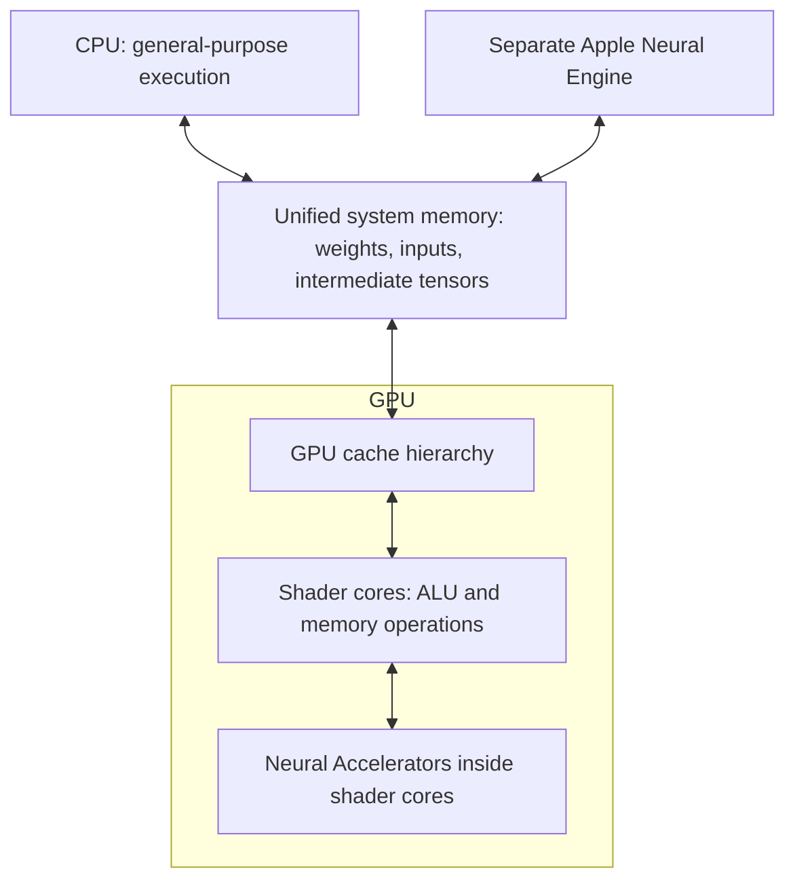

# M5 Max and M5 Ultra: the architecture underneath native AI

Public-source architecture research, 2026-10-19. This chapter explains processors, memory, execution, and scaling. It draws on Apple specifications, Metal documentation, and Apple engineering presentations. Calculations are explicitly identified as idealized derivations.

## What Apple has publicly documented

M5 Ultra is an officially documented product, not a hypothetical successor in this study. Apple's announcement is dated August 25, 2026. Its published description includes GPU Neural Accelerators and 1.2 TB/s memory bandwidth. [Apple announcement](https://www.apple.com/ca/newsroom/2026/08/apple-introduces-new-mac-studio-with-m5-max-and-m5-ultra/).

The current public Mac Studio specifications distinguish these chip variants:

| Chip variant | CPU cores | GPU cores | Separate Neural Engine cores | Published memory bandwidth |
|---|---:|---:|---:|---:|
| M5 Max | 18 | 32 | 16 | 460 GB/s |
| M5 Max | 18 | 40 | 16 | 614 GB/s |
| M5 Ultra | 30 | 64 | 32 | 1.2 TB/s |
| M5 Ultra | 36 | 80 | 32 | 1.2 TB/s |

These are Apple's public specifications, not application throughput. GPU core count and Neural Engine core count describe different hardware. The bandwidth figures also show why “M5 Max” alone is insufficient to identify a performance target. [Apple technical specifications](https://www.apple.com/mac-studio/specs/).

Apple documents M5 Pro/Max as using its Fusion Architecture to combine two dies into one SoC. This does not supply an M5 Ultra interconnect specification. The reviewed M5 Ultra announcement and specifications do not disclose link bandwidth, latency, cache topology, or a quantitative cross-die penalty. No such number is assumed below. [M5 Pro/Max architecture announcement](https://www.apple.com/newsroom/2026/03/apple-debuts-m5-pro-and-m5-max-to-supercharge-the-most-demanding-pro-workflows/).

## One main-memory pool, several kinds of execution

RAM stores information; the CPU, GPU, and specialized accelerators perform computation. Apple silicon's unified memory lets CPU and GPU access the same system-memory pool. Metal still distinguishes resources the CPU may access from GPU-only resources: both `shared` and `private` resources use system memory on Apple GPUs. `private` means GPU-only access, not a separate physical VRAM bank. [Apple GPU storage modes](https://developer.apple.com/documentation/metal/choosing-a-resource-storage-mode-for-apple-gpus).

A model therefore does not need to be “manually unified.” Its execution engine has to represent the model's operations, choose supported compute paths, manage intermediate data, and honor dependencies. MLX provides a concrete example: arrays reside in unified memory while operations select CPU or GPU streams; dependent operations are ordered by the framework. This removes a conventional device-transfer boundary but does not erase scheduling or memory costs. [MLX unified-memory semantics](https://ml-explore.github.io/mlx/build/html/usage/unified_memory.html).



This is a functional diagram, not a physical floorplan or interconnect specification. Core ML exposes CPU, GPU, and Neural Engine as distinct compute devices, while Apple's M5 GPU description places Neural Accelerators beside the ALU pipelines within shader cores. The two meanings of “neural” must remain separate. [Core ML device types](https://developer.apple.com/documentation/CoreML), [M5 GPU architecture](https://developer.apple.com/videos/play/tech-talks/111432/).

## Unified memory still has a hierarchy

The shared system-memory pool is the largest conceptual storage tier in this explanation. GPU caches and the working state of executing shaders form nearer tiers. In M5, Dynamic Caching allocates shader registers and other private shader storage dynamically through the on-chip hierarchy. The occupancy manager considers cache pressure and other execution conditions. Consequently, declared local variables are not a promise of unlimited, permanently resident physical registers. [M5 caching and occupancy](https://developer.apple.com/videos/play/tech-talks/111431/).

Metal's address spaces describe access and lifetime relationships. A `device` buffer can hold data shared by many kernel invocations; `threadgroup` storage lets threads in one group cooperate; thread-local state belongs to an individual thread. Address-space choice affects access patterns and memory demand. Apple's shader guidance specifically warns that staging data into threadgroup memory merely to create a software cache can duplicate what the hardware cache already does well. [Metal shader performance guidance](https://developer.apple.com/videos/play/tech-talks/111373/?time=409).

Tile memory is another term that needs precision. Apple describes it as GPU-local storage usable for threadgroup or imageblock data. It is not the unified-memory pool and not an extra general-purpose store for entire models. Memoryless resources are temporary textures rather than buffers. Imageblocks and threadgroup reservations also consume a bounded shared allocation. [Compute-pass tile memory](https://developer.apple.com/documentation/metal/compute-passes), [imageblock allocation](https://developer.apple.com/documentation/metal/mtlcomputecommandencoder/setimageblockwidth(_:height:)), [memoryless resources](https://developer.apple.com/documentation/metal/choosing-a-resource-storage-mode-for-apple-gpus).

The causal consequence is that two kernels reading the same number of model bytes can perform differently: one may reuse nearby data before eviction, while the other repeatedly fetches it. Conversely, increasing simultaneously active work can enlarge the working set until caches thrash. M5's occupancy manager may reduce concurrency for precisely that reason; maximum occupancy is not inherently maximum throughput. [M5 occupancy management](https://developer.apple.com/videos/play/tech-talks/111431/).

## How work reaches the GPU

Metal launches a grid of threads divided into threadgroups. Each group contains SIMD groups whose lanes execute the same program on different data. Divergent control flow within a SIMD group can require execution of multiple paths. The pipeline's `threadExecutionWidth` supplies the actual SIMD width; a CPU core count or GPU core count is not a substitute for that width. [Threads and threadgroups](https://developer.apple.com/documentation/metal/creating-threads-and-threadgroups).

A threadgroup is a cooperative work unit, not a physical core. Different groups can be distributed over processing elements. The permissible group size is also pipeline-dependent: a complicated kernel can have a different limit from a simple one. Thus “use the largest group” and “one group per GPU core” are neither universal performance rules nor architectural identities. [Apple GPU computation example](https://developer.apple.com/documentation/metal/performing-calculations-on-a-gpu).

Shared physical memory does not make simultaneous reads and writes automatically safe. A producer must finish before a dependent consumer uses its result. Within shaders, barriers establish the required ordering; across passes, appropriate fences, barriers, or events perform that role. In Metal 4, work submitted through `MTL4CommandQueue` does not gain automatic protection from `hazardTrackingMode`. Synchronization rules therefore belong to the execution model, not to the mere existence of unified memory. [Resource synchronization](https://developer.apple.com/documentation/metal/resource-synchronization), [Apple-silicon shader synchronization](https://developer.apple.com/documentation/apple-silicon/porting-your-metal-code-to-apple-silicon).

## GPU Neural Accelerators and tensor operations

M5's GPU Neural Accelerators perform matrix operations inside each shader core, near ordinary shader ALU execution. That locality allows a kernel to combine accelerated multiplication with custom arithmetic. Apple describes TensorOps as the direct shader-level route and higher-level frameworks as other routes to this hardware. An engine's supported kernel path still determines whether a particular operation benefits; an accelerator's existence does not accelerate every instruction. [Apple M5 machine-learning talk](https://developer.apple.com/videos/play/tech-talks/111432/).

A Metal tensor carries dimensions, strides, type, and a reference to storage. TensorOps can operate over selected slices, dividing a matrix product into tiles. A cooperative tensor distributes intermediate values among participating threads, allowing a subsequent activation to operate on the result before it is written to device memory. Apple's inline example uses this to fuse matrix multiplication and ReLU. It also explains why explicit threadgroup staging and manually pipelined memory copies are not prerequisites for these Apple GPU tensor kernels. [Inline Metal tensor operations](https://developer.apple.com/documentation/metal/running-inline-ml-operations-in-a-shader-with-metal-4).

Fusion saves traffic, but the fused live state must still fit efficiently. Larger tiles improve reuse until their register footprint, edge waste, or reduced number of runnable groups becomes costly. Apple's MPP guide discusses tile geometry, locality-preserving group traversal, and periodically keeping accumulation groups near one another in the inner dimension. These are tradeoffs, not fixed magic constants. All threads required by a TensorOps execution scope must participate. [MPP programming guide, sections 2–3](https://developer.apple.com/download/files/Metal-Performance-Primitives-Programming-Guide.pdf).

The same idea extends beyond an activation. Apple's WWDC26 material demonstrates keeping attention intermediates in cooperative tensors, applying row reductions and softmax, then consuming those values in another multiplication. It also describes quantized tensors and passing compressed operands into TensorOps so the implementation can use supported acceleration. This is an implementation mechanism; it does not prove equivalent accuracy for arbitrary quantization schemes or compatibility with every model format. [Custom operations with Metal tensors](https://developer.apple.com/videos/play/wwdc2026/330/).

## Why bandwidth and compute lead to different answers

Arithmetic intensity is useful work divided by memory traffic. Let `F` be floating-point operations, `Q` the bytes fetched/written at a chosen memory boundary, `C` the effective compute ceiling, and `B` the effective bandwidth there. A simplified roofline bound is:

```text
I = F / Q                         operations per byte
T >= max(F / C, Q / B)             idealized time lower bound
achievable rate <= min(C, B * I)
```

These equations express two unavoidable resource costs; perfect overlap takes the larger one. Real execution can add launch, synchronization, conversion, and cache-miss costs. Apple's GEMM appendix uses this same distinction between arithmetic work and memory traffic and explicitly assumes ideal input reuse in its simplified analysis. [MPP guide, appendix 4.1](https://developer.apple.com/download/files/Metal-Performance-Primitives-Programming-Guide.pdf).

For a matrix product `(M × K) × (K × N)`, counting a multiply-add as two operations and assuming equal-size elements of `q` bytes, a direct derivation gives:

```text
F ≈ 2 * M * N * K
Q_min = q * (M*K + K*N + M*N)
I_ideal = 2*M*N*K / [q*(M*K + K*N + M*N)]
```

This idealization reads each input once and writes each output once; it excludes extra accumulator reads, scales, and layout conversions. For an illustrative FP16 matrix-vector product with `M=1` and large `K,N`, intensity approaches one operation/byte. For square FP16 matrices of side 4096, the formula gives about 1365 operations/byte. These are mathematical examples, not measured kernels. They explain why a high-throughput matrix unit can be well used by one shape and starved for data by another.

As a second illustration, suppose an operation must stream 10 GB through main memory. Using the advertised upper bandwidths only, `Q/B` is about 16.3 ms at 614 GB/s and 8.3 ms at 1.2 TB/s. These are optimistic transfer floors, excluding all additional work and assuming the entire published bandwidth is available. They are not token rates or expected timings. The source of the two hardware numbers is [Apple's specification table](https://www.apple.com/mac-studio/specs/); the division is our derivation.

Large prompt processing often offers enough matrix reuse to emphasize compute throughput; one-token-at-a-time decoding often reads substantial weights for comparatively little arithmetic. Apple explicitly uses this contrast to explain M5's different gains in prefill and decoding. Treat it as a tendency: batching, context length, sparsity, quantization, and shape can move an operation to a different region of the roofline. [M5 inference explanation](https://developer.apple.com/videos/play/tech-talks/111432/).

## CPU, GPU, and ANE as a pipeline

The separate Neural Engine is available through framework execution paths rather than being the destination of an ordinary Metal compute dispatch. Core ML's `all` policy permits the framework to select available devices; `cpuAndGPU` and `cpuAndNeuralEngine` expose different permitted sets. Permission to use all units does not assert that every model runs on all of them simultaneously. [Core ML compute policies](https://developer.apple.com/documentation/coreml/mlcomputeunits?changes=l_3).

Metal 4 additionally supports model inference as a machine-learning pass on the GPU timeline. Its output can feed later GPU passes without requiring the CPU to collect the result between stages. This differs from inline TensorOps inside one kernel and from choosing Core ML's broader device policy. Model preparation, tensor bindings, intermediate storage, and dependencies remain real requirements. [Model inference on the GPU timeline](https://developer.apple.com/documentation/metal/running-a-machine-learning-model-on-the-gpu-timeline).

A conceptual multimodal pipeline might decode an image, normalize/resize pixels, produce vision embeddings, process text and embeddings, then generate output tokens. Mapping those stages to engines is a scheduling problem. In a compatible media path, Core Video can map an existing image buffer to a Metal texture; pixel-format compatibility and lifetime still matter. “Image straight to GPU” can mean avoiding an unnecessary copy, not bypassing RAM or magically removing decoding. [Core Video texture mapping](https://developer.apple.com/documentation/corevideo/cvmetaltexturecachecreatetexturefromimage(_:_:_:_:_:_:_:_:_:)).

For sequentially dependent stages, an analytical model is `T_request = Σ T_stage + Σ T_boundary`. A new processor helps only when faster execution outweighs conversion, handoff, and waiting costs. Independent items can be pipelined; with sufficient overlap, steady-state throughput is constrained by the slowest stage, while individual latency still includes its path. This is a scheduling deduction, consistent with Apple's producer/consumer examples, not a recommendation to split a specific model between devices. [CPU/GPU producer-consumer coordination](https://developer.apple.com/documentation/metal/synchronizing-cpu-and-gpu-work).

## Scaling from Max to Ultra

More GPU cores create more parallel compute capacity, but a workload must expose enough suitable work to occupy them. Larger group tiles can leave too few groups to distribute or an uneven final wave. Kernel launch cost, serial CPU work, memory traffic, and dependencies do not automatically shrink in proportion to core count. Apple's group-sizing example and MPP tiling analysis provide the underlying mechanisms. [Compute-group distribution](https://developer.apple.com/documentation/metal/performing-calculations-on-a-gpu), [MPP tiling](https://developer.apple.com/download/files/Metal-Performance-Primitives-Programming-Guide.pdf).

Using the published bandwidth values, the ratio between 1.2 TB/s and 614 GB/s is about 1.95. It is a hardware ratio, not a promised application speedup. For illustration, if 80% of elapsed time improved by exactly that factor while 20% stayed fixed, Amdahl's relationship gives `S = 1 / (0.2 + 0.8/1.95) ≈ 1.64`. This explicitly hypothetical calculation shows why even ideal scaling of the dominant stage does not double the complete task.

A shared address space also does not prove identical latency for every access in a physically distributed design. Without a documented M5 Ultra topology and interconnect characterization, conclusions about cross-die bandwidth, remote-cache penalties, or memory placement remain conditional. No older Ultra's interconnect number is transferred to M5 Ultra, and no Max specification is multiplied to invent one. The verified statements are limited to the public M5 Ultra specification and announcement. [Apple specifications](https://www.apple.com/mac-studio/specs/), [M5 Ultra announcement](https://www.apple.com/ca/newsroom/2026/08/apple-introduces-new-mac-studio-with-m5-max-and-m5-ultra/).

The architecture-level objective is therefore precise: make supported operations reuse data, keep useful intermediates close to computation, expose enough independent work, and preserve correct ordering. Shared memory, GPU tensor acceleration, and a separate Neural Engine are complementary capabilities. Their presence is established; the best decomposition of a particular model remains an algorithm- and workload-specific question.

Sources and the explicit uncertainty boundary are recorded in [hardware-sources.json](hardware-sources.json).
