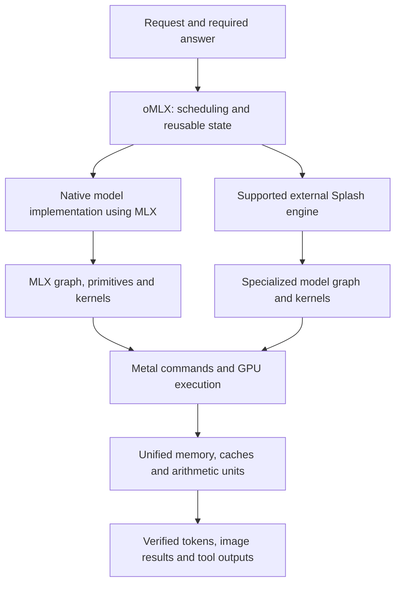

# From model mathematics to a useful response

This chapter explains the general software stack. It does not describe a particular user's installation. Source identities for the inspected mechanisms are MLX `f41bec734ac9fc96723ab7d4e64e385796f15561`, oMLX `c4605a2dcdf03bf8cb58594d34fb2b0089e60304`, and Splash `be3b083c5f413673d44e44881042e875e674e333`. A later release can change these implementations.

## A model, framework, engine and server do different jobs

A language model specifies a function and learned parameters. Given a token sequence and state, it computes scores for subsequent tokens. Its architecture determines which operations and dependencies are required: projections, attention or recurrence, normalization, feed-forward/expert blocks, and a vocabulary projection. A sampler converts the scores into a token decision. Training changes parameters using a loss and gradients; inference evaluates the trained function. These are different workloads, even when they use the same matrix operations. [MLX model implementations](https://github.com/ml-explore/mlx-lm/tree/main/mlx_lm/models), [MLX automatic differentiation](https://ml-explore.github.io/mlx/build/html/usage/function_transforms.html).

| Layer | Role | What can improve here |
| --- | --- | --- |
| Model architecture and weights | Specify computation and learned behavior | Fewer necessary parameters/operations, smaller state, better low-precision tolerance, better drafting or task efficiency |
| MLX | Arrays, differentiation, graph transformations and execution on supported devices | Fusion, kernels, layouts, evaluation boundaries and memory reuse |
| MLX-LM / MLX-VLM | Concrete language/vision model implementations, tokenization/processing and generation utilities | Model support, efficient state representations, sampling and model-specific paths |
| oMLX | Request handling, scheduling, engine lifecycle, caching and serving interfaces | Avoid repeated work; coordinate concurrent users; preserve useful state; select supported execution engines |
| Splash | Specialized model execution, state management, kernels, speculation and serving | Joint optimization of a small set of model families and their native execution paths |
| Metal and Metal Shading Language | Host GPU resource/command API and GPU programs | Efficient use of buffers, threads, synchronization and hardware arithmetic |
| metal-cpp | C++ bindings to the host Metal API | Correct native integration and ownership; it does not itself change model mathematics |

The table is a functional map, not a requirement that all layers appear in one linear chain. In particular, Splash is an alternative native engine. A serving layer can send work to Splash without evaluating that model through MLX. The same checkpoint format can be consumed by different engines; a safetensors file or GGUF file does not determine which runtime executes it. [oMLX engine selection](https://github.com/jundot/omlx/blob/c4605a2dcdf03bf8cb58594d34fb2b0089e60304/omlx/engine_pool.py#L2084), [Splash model loading](https://github.com/incoai/splash/blob/be3b083c5f413673d44e44881042e875e674e333/runtime/model/ModelFactory.cpp#L14), [metal-cpp forwarding](https://github.com/apple/metal-cpp/blob/8cdde68ae36a636c84cbb48ebcbc8f3b60251ea0/Foundation/NSObject.hpp#L184).

Optional CPU and ANE work complicate the diagram; they do not turn these software products into synonyms. M5 Max and M5 Ultra provide hardware resources. The framework and engine decide how a concrete computation uses them.

## What MLX contributes

MLX is an array framework designed for Apple Silicon. Its shared-memory model means arrays are not mechanically copied between a CPU-owned bank and a GPU-owned bank whenever an operation changes device. Execution is selected per operation/stream, and dependency management ensures a consumer waits for its producer. The inspected Metal allocator uses shared resources and caches allocations; this is an existing implementation mechanism. [Unified-memory semantics](https://ml-explore.github.io/mlx/build/html/usage/unified_memory.html), [allocator source](https://github.com/ml-explore/mlx/blob/f41bec734ac9fc96723ab7d4e64e385796f15561/mlx/backend/metal/allocator.cpp#L15).

Array expressions can first create a lazy graph. MLX can evaluate the graph, differentiate functions, or compile eligible work. Compilation can fuse operations and avoid intermediates, but is not a guarantee that an arbitrary whole model becomes a single ideal kernel. Shapes, state, supported operations and compilation boundaries matter. Cold compilation and warm reuse are different costs. [Lazy evaluation](https://ml-explore.github.io/mlx/build/html/usage/lazy_evaluation.html), [compilation](https://ml-explore.github.io/mlx/build/html/usage/compile.html).

Consider `normalize → multiply → add → activate`. Separate GPU operations may write intermediates to memory and launch several kernels. A fused implementation can keep values closer to the arithmetic units and reduce launches. It can also increase register use, hurt occupancy, or specialize poorly for a different shape. The relevant question is whether the resulting dependency graph and memory traffic are better for the actual workload. MLX exposes custom Metal kernels for cases that justify more specialized code. [Custom kernels](https://ml-explore.github.io/mlx/build/html/dev/custom_metal_kernels.html).

Shared memory does not guarantee zero copying. The quantized backend explicitly makes contiguous copies for some input layouts. It dispatches different matrix-vector and matrix-matrix kernels according to shape, precision and hardware. A useful architecture is therefore one whose frequent operations map to efficient supported shapes and formats, not merely one with a smaller nominal parameter count. [Layout normalization](https://github.com/ml-explore/mlx/blob/f41bec734ac9fc96723ab7d4e64e385796f15561/mlx/backend/metal/quantized.cpp#L55), [quantized dispatch](https://github.com/ml-explore/mlx/blob/f41bec734ac9fc96723ab7d4e64e385796f15561/mlx/backend/metal/quantized.cpp#L465).

MLX's synchronization is also real work with correctness obligations. The evaluator tracks dependencies and dispatches CPU/GPU primitives; the command encoder tracks resources and inserts barriers/fences. Removing a wait can produce an apparently faster timer simply by leaving unfinished GPU work outside the measured interval. It can also read stale data. An optimization must preserve completion and lifetime semantics. [Evaluation](https://github.com/ml-explore/mlx/blob/f41bec734ac9fc96723ab7d4e64e385796f15561/mlx/transforms.cpp#L235), [command encoding](https://github.com/ml-explore/mlx/blob/f41bec734ac9fc96723ab7d4e64e385796f15561/mlx/backend/metal/device.cpp#L350).

## Why prompt processing and token generation behave differently

During prompt processing, many token positions are already known. The model can process projections over many rows together, while respecting causal attention. That often permits substantial weight reuse and matrix-matrix work. During ordinary single-sequence decoding, the next input token depends on the previous decision. Each new token can require another pass through substantial model weights, using much skinnier operations. This helps explain why one engine can have excellent prompt throughput and modest generation speed. It also explains the appeal of batching and speculative verification. [Splash prefill implementation](https://github.com/incoai/splash/blob/be3b083c5f413673d44e44881042e875e674e333/runtime/model/QwenTarget.cpp#L171), [MLX quantized paths](https://github.com/ml-explore/mlx/blob/f41bec734ac9fc96723ab7d4e64e385796f15561/mlx/backend/metal/quantized.cpp#L832).

Attention adds another source of traffic as context grows. The FlashAttention research demonstrates the general principle that moving data through the memory hierarchy can dominate an implementation: tiled attention reduces expensive reads/writes without replacing exact attention with an approximation. Its paper's GPU measurements are not M5 benchmarks, and Splash's own attention implementation must be identified separately. The transferable lesson is to optimize movement as well as arithmetic. [Original FlashAttention paper](https://arxiv.org/abs/2205.14135).

## What makes oMLX useful

oMLX can accelerate the user's experienced result without changing a single trained weight. It can avoid repeated prompt work, retain state, batch compatible requests, interleave long prefills with ongoing decodes and manage model lifetimes. These are system-level improvements. An isolated kernel benchmark does not measure them. The inspected scheduler builds on MLX-LM generation with additional model-specific paths. [Scheduler](https://github.com/jundot/omlx/blob/c4605a2dcdf03bf8cb58594d34fb2b0089e60304/omlx/scheduler.py#L1857), [generator construction](https://github.com/jundot/omlx/blob/c4605a2dcdf03bf8cb58594d34fb2b0089e60304/omlx/scheduler.py#L3629).

Cache correctness is more demanding than “have we seen these words?” A reusable prefix depends on exact tokenization, model identity, previous blocks and relevant media. A hybrid model may need recurrent state as well as attention keys and values. State after a sequence is not necessarily invertible into state before its final token. A nominal exact hit can therefore still need some recomputation. oMLX's inspected cache and scheduler explicitly represent these cases. [Prefix identity](https://github.com/jundot/omlx/blob/c4605a2dcdf03bf8cb58594d34fb2b0089e60304/omlx/cache/paged_cache.py#L84), [restoration](https://github.com/jundot/omlx/blob/c4605a2dcdf03bf8cb58594d34fb2b0089e60304/omlx/cache/prefix_cache.py#L810), [hybrid exact-hit handling](https://github.com/jundot/omlx/blob/c4605a2dcdf03bf8cb58594d34fb2b0089e60304/omlx/scheduler.py#L10420).

SSD state caching exchanges recomputation for serialization, I/O and reconstruction. It does not increase physical memory bandwidth or make an arbitrary oversized resident workload fast. The best policy depends on the workload's repeated prefixes, restoration cost and memory pressure. Likewise, batching can improve aggregate throughput by sharing weight work while increasing the wait experienced by one request. An architecture study should specify whether it optimizes interactive latency, many-client throughput, energy, or capacity.

The external Splash adapter changes the compute engine for eligible models. It proxies requests to a separate process with its own scheduling, caches, speculation and memory budget. Native MLX controls cannot be assumed to configure that independent path. This architectural boundary matters even when clients use an identical API. [Splash adapter launch and proxy](https://github.com/jundot/omlx/blob/c4605a2dcdf03bf8cb58594d34fb2b0089e60304/omlx/engine/splash.py#L907).

## Images have several reusable representations

A multimodal request begins with encoded image bytes. Decoding produces pixels, processing makes model-specific tensors or patches, a vision encoder produces features, and the language model consumes those features with text. Reducing image copies can help, but reducing redundant vision computation or unnecessary visual tokens can save more when those dominate. The latter may require training or can sacrifice important small details; it must be tested on the intended task.

The inspected oMLX path has separate decoded-image and projected-feature reuse, plus language-prefix state that includes media identity. This separation gives a useful design principle: cache at the representation boundary where expensive work has completed and identity is stable. A text-identical prompt with a different picture is not the same multimodal state. [Image decode](https://github.com/jundot/omlx/blob/c4605a2dcdf03bf8cb58594d34fb2b0089e60304/omlx/utils/image.py#L216), [feature cache](https://github.com/jundot/omlx/blob/c4605a2dcdf03bf8cb58594d34fb2b0089e60304/omlx/cache/vision_feature_cache.py#L76), [partial image processing](https://github.com/jundot/omlx/blob/c4605a2dcdf03bf8cb58594d34fb2b0089e60304/omlx/engine/vlm.py#L4502).

## Optimize the critical path to a correct result

An engineering decomposition is:

`task time = queue/load + input preparation + uncached prefill + generation + tools/retries + remaining delivery work`

Some stages overlap, so this is accounting guidance rather than a universal additive timing equation. Attribute time using traces and actual dependencies. For a nonoverlapping toy example, if 2 of 10 seconds are GPU prompt work and that part becomes twice as fast, the total becomes 9 seconds, only about 1.11× faster. If 8 seconds instead become twice as fast, total time becomes 6 seconds, about 1.67× faster. These are arithmetic illustrations, not performance measurements.

A more capable model may finish a task with fewer retries or generated tokens, even if its raw tokens/second is lower. Conversely, a model trained to be concise may be faster because it skips necessary reasoning and fails more often. Count successful task completions, output quality and complete response time together. This connects the framework, serving system, and training problem: each layer changes a different component of the same outcome.

The practical inference is that Apple-native AI design must join three forms of knowledge: what the model actually needs to calculate; how the hardware makes data movement and arithmetic expensive; and how real request histories create reusable work. No single GPU setting can replace that joint analysis.
